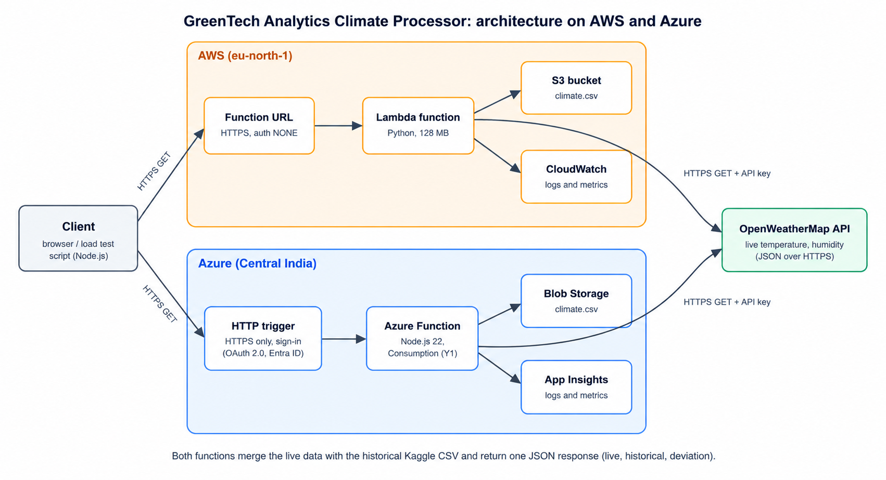

# GreenTech Analytics — Serverless Climate Processor

**Modular Assignment 1 | Introduction to Cloud Computing (IHC – Cloud Development)**  
**Author:** Md Habib Ahmed  
**Cloud platforms:** AWS Lambda (`eu-north-1`, Stockholm) and Azure Functions (Central India)  
**Project status:** Completed coursework demonstration; live endpoint availability is not guaranteed.

GreenTech Analytics is a dual-cloud serverless prototype that combines **current weather observations** from the OpenWeatherMap API with **historical temperature records** from the Kaggle Earth Surface Temperature dataset. Two independently deployed implementations return comparable JSON responses, allowing the deployment experience, request latency, monitoring, and operational trade-offs to be examined side by side.



## Project contents

| Location | Purpose |
|---|---|
| [`aws-lambda/`](aws-lambda/) | Python implementation for AWS Lambda |
| [`azure-function/`](azure-function/) | Node.js implementation for Azure Functions |
| [`load-test/`](load-test/) | Node.js comparative HTTP load-test script |
| [`docs/architecture-diagram.png`](docs/architecture-diagram.png) | AWS/Azure processing architecture |
| [`screenshots/`](screenshots/) | Deployment, API response, performance, monitoring, and security evidence |
| [`docs/Introduction To CC-M1-Report.docx`](docs/Introduction%20To%20CC-M1-Report.docx) | Formatted Modular Assignment 1 report |

## Architecture and data flow

1. A browser or test client sends an HTTPS request with a city parameter, such as `?city=Abha`.
2. AWS Lambda or Azure Functions requests live temperature and humidity from **OpenWeatherMap**.
3. The function reads the Abha historical-temperature CSV from **Amazon S3** or **Azure Blob Storage**.
4. The response combines the current observation, historical record count, historical average, and temperature deviation in JSON.
5. **Amazon CloudWatch** and **Azure Application Insights** provide platform-specific execution and monitoring information.

The two implementations use different runtimes and regions. Their results therefore illustrate this specific deployment rather than a controlled, provider-wide comparison.

## API and data sources

**Example request:** `GET /?city=Abha` on the AWS Function URL, or `GET /api/climateFunction?city=Abha` on the Azure Function App.

**Example AWS response recorded during testing** (weather values change over time):

```json
{
  "service": "GreenTech Analytics Climate Processor",
  "cloud_provider": "AWS Lambda",
  "live": {
    "city": "Abha",
    "temperature_c": 23.14,
    "humidity_pct": 14
  },
  "historical": {
    "records_used": 1825,
    "first_date": "1861-01-01",
    "latest_date": "01-08-2013",
    "avg_temperature_c": 24.48
  },
  "temperature_deviation_c": -1.34
}
```

- **Live source:** [OpenWeatherMap Current Weather API](https://openweathermap.org/current), requiring an API key.
- **Historical source:** Kaggle's *Climate Change: Earth Surface Temperature Data* (by-city CSV), filtered to Abha. The historical subset has **1,825 records** spanning **1861–2013**, with a calculated average of **24.48 °C**.
- **Dataset limitation:** The CSV does **not** contain CO₂ observations, so the prototype does not report CO₂ measurements. The Kaggle CSV is not bundled in this repository; obtain it from the source and prepare `climate.csv` for deployment.

## Recreate the demonstration

> **Cloud resources may incur charges.** Use your own cloud accounts, storage names, and API credentials. Do not commit keys, connection strings, or other secrets to GitHub.

### AWS Lambda — Stockholm (`eu-north-1`)

1. Create an S3 bucket and upload the prepared `climate.csv`.
2. Create a Python Lambda function using [`aws-lambda/lambda_function.py`](aws-lambda/lambda_function.py), with **128 MB memory** and a **15-second timeout**.
3. Configure environment variables: `OPENWEATHER_API_KEY`, `BUCKET_NAME`, and `CSV_KEY` (for example, `climate.csv`).
4. Grant the execution role the required S3 read and logging permissions. Avoid broad administrative policies.
5. For a test deployment, configure a Function URL and invoke it with `?city=Abha`. The original demonstration used `NONE` authentication; this is **not recommended for a public production API**.

### Azure Functions — Central India

1. Create a storage account, a `climate-data` Blob container, and upload `climate.csv`.
2. Create a **Node.js 22** Function App on the Windows Consumption (Y1) plan, consistent with the recorded demonstration.
3. Configure `OPENWEATHER_API_KEY` and `STORAGE_CONNECTION_STRING` as application settings.
4. Deploy [`azure-function/climateFunction/index.js`](azure-function/climateFunction/index.js) with dependencies from [`azure-function/package.json`](azure-function/package.json), including `@azure/storage-blob`.
5. Invoke `/api/climateFunction?city=Abha`. Microsoft Entra ID sign-in was added after the unauthenticated response screenshots were taken, so protected access may require sign-in.

The Azure free-trial subscription imposed region/runtime restrictions during setup, which led to using Node.js rather than the initially preferred Python runtime. Application Insights also required additional configuration.

## Recorded load-test results

A Node.js script in [`load-test/`](load-test/) sent **50 requests per endpoint at concurrency 10** in each run. Two runs were recorded for each cloud provider from the same workstation.

| Metric | AWS run 1 | AWS run 2 | Azure run 1 | Azure run 2 |
|---|---:|---:|---:|---:|
| Average latency | 642 ms | 504 ms | 2,928 ms | 360 ms |
| Median latency | 339 ms | 348 ms | 186 ms | 208 ms |
| Slowest request | 2,201 ms | 1,057 ms | 16,217 ms | 2,292 ms |
| Script-reported errors | 0 | 0 | 0 | 0 |

The first runs may include cold-start overhead. AWS and Azure ran in **different geographic regions**, and client-to-region network conditions were not controlled. These measurements should not be interpreted as universal performance rankings.

CloudWatch showed **10 concurrent Lambda executions** in the observed view. Azure Application Insights showed **101 successful and two failed invocations overall**; the two failures were not reproduced as errors by the scripted load tests, and their cause was not established.

## Security, cost, and known limitations

- Both implementations used HTTPS. API keys and storage connection details were configured through environment variables/application settings rather than embedded in source code.
- The AWS Function URL was publicly callable during testing. Its execution role also had `PowerUserAccess`, broader than required; production use should enforce authentication and least-privilege IAM.
- Azure built-in authentication using Microsoft Entra ID was enabled **after** the public JSON demonstration.
- Azure showed **$0.00** in the observed cost view; AWS showed **$120 of remaining promotional credit**. Remaining credit is **not a measured AWS usage cost**, so these observations cannot establish a precise price comparison.
- The sample size was small, the provider regions differed, the historical data lacks CO₂, and maximum scaling capacity was not tested.
- Historical CSV dates may appear in different formats; this did not change the recorded temperature average.

## Assignment evidence and documentation

- [Formatted Modular Assignment 1 report](docs/Introduction%20To%20CC-M1-Report.docx)
- [Architecture diagram](docs/architecture-diagram.png)
- [Deployment and test screenshots](screenshots/)
- [AWS Lambda source](aws-lambda/)
- [Azure Functions source](azure-function/)
- [Load-testing script](load-test/)

This repository documents a completed educational prototype, including its real test observations and limitations. It is **not a production-ready service**, and its cloud endpoints should not be assumed to remain available.
